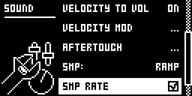
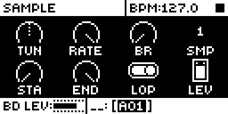
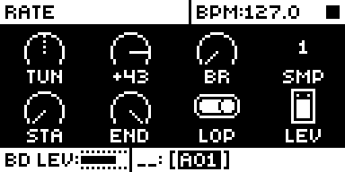
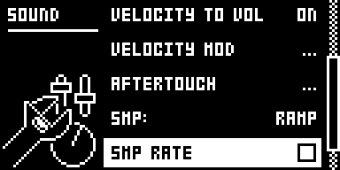
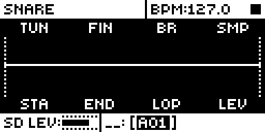

# Sample RATE

An Analog Rytm MKII mod by npp1993 (Nathaniel Pavel). Version 0.1.0-experimental, OS 1.74 with core-ar2 0.7.

## Overview

Sample RATE gives a sample a pure speed control, the Octatrack's RATE with its setting on PTCH: no time stretch, just the sample played faster or slower, down to a stop and on into reverse. Stock's pitch stops at a quarter of the speed. RATE carries on to zero.

Switch it on for a sound with SMP RATE in SOUND SETTINGS, or by tapping FIN's knob on the SAMPLE page. The knob then reads RATE, +63 to -64. +63 plays at normal speed, 0 stops the sample, -64 plays it backward at normal speed, and the speed scales in a straight line between them. TUN stays as it is and multiplies RATE, up to stock's 4x.

The setting belongs to the sound: it saves with it and it is off by default. A sound with it off plays exactly as stock.

 

## Controls

| Control | Where | Values |
| --- | --- | --- |
| SMP RATE | SOUND SETTINGS, under SMP: | A checkbox. Clear: stock. Checked: FIN is RATE on this sound. LEFT and RIGHT set it, YES turns it over. |
| Tap of encoder B | SAMPLE page, either view | Turns SMP RATE over for the selected sound: press and let go within about 0.4 s. The first two encoder steps of a press are ignored, so a click that nudges the knob still counts. Stock's press and hold are otherwise unchanged. |
| RATE | SAMPLE page, encoder B (FIN's knob) | +63 to -64. +63 is 1x, +32 is 0.5x, 0 stops, -32 is -0.5x, -64 is -1x. |

Switching on takes a FIN at its rest (+0) to RATE +63, so the sound keeps playing at normal speed. Switching off takes RATE +63 back to FIN +0. Any other value stays as it is, so turning the row off and on again keeps a RATE you set, and a sound with a real detune keeps that number. A detuned sound therefore starts slow: FIN +10 reads RATE +10, 0.16x.

## Usage

Select a track whose sound plays a sample. Press SMPL and tap encoder B: the knob reads RATE. Or press FUNC + FILTER, choose SOUND SETTINGS, go to SMP RATE and press RIGHT.

### Quick tutorial

1. Put a long sample on a track, with LOP ON. Press SMPL and tap encoder B: FIN's knob reads RATE.
2. Play the pad. Turn RATE down from +63: the sample slows like a stopping turntable and rests at 0.
3. Keep turning below 0: it runs backward, smoothly through the stop. A new trig now starts from END.
4. Hold a trig in GRID RECORDING and turn RATE to lock it on that step: a trig at -63 plays backward from END, and the next trig plays forward again.

### What it overrides and what still applies

RATE replaces FIN in the sample's pitch. TUN, the trig's note on a chromatic track and every modulation of TUN still apply, and multiply RATE. Parameter locks, scene and performance locks and LFOs reach RATE as they reach FIN: they are the same parameter, and the sample glides between values as stock's parameters do. STA, END, LOP and the sample slot behave as stock. It covers the sample layer of a sound on any track; the analog voice is untouched. FIN's MIDI CC 25 sets RATE, and it holds across trigs as FIN does on stock.

- With RATE below 0 a trig starts from END and plays towards STA. With END set below STA (stock's backward play) that makes it run forward, the opposite way to stock's backward.
- With LOP ON the sample loops the way it is going. With LOP OFF it plays once and stops at STA.
- At 0 the voice holds its last value while the AMP envelope is open, like a stopped tape.

### Changes to stock flows

- **A new row in SOUND SETTINGS.** What changes: SMP RATE sits after SMP:, with LEGACY FX SEND one row lower. Why: the setting belongs to the sound, as ENV RESET and CHROMATIC do, and SOUND SETTINGS is where those live; taking FIN's knob for good, or a FUNC gesture on it, was considered, but Loop Sync holds FUNC + TUN and FIN, and a sound must keep playing as stock until asked. What you see: one more row, a clear checkbox like LEGACY FX SEND's. It applies only in a build with this mod. Checked beside it: the list scrolls, the rows above it stay stock's, and LEFT, RIGHT and YES act on this row alone. Env Reset Amp was not run beside it.
- **FIN's name and value on a sound with RATE on.** What changes: on the SAMPLE page FIN's label and the header read RATE, and the value keeps stock's -64 to +63. Why: the knob no longer does what FIN says. It follows the selected track's sound, and a sound with the row off shows stock. LFO destination lists and other screens still say FIN, and a held trig's sound lock shows the track's own name for the knob.
- **A tap of FIN's knob.** What changes: on the SAMPLE page a short press of encoder B turns SMP RATE over. The first two encoder steps of any plain press of that knob are ignored, so a press and turn starts two steps later than on stock. Why: switching FIN and RATE while working on a sound beats a menu trip. What you see: the label and value change at once; stock's press still shows the parameter. It applies only in a build with this mod, and SOUND SETTINGS does the same job. A press with a trig, FUNC or NO held, with a pad held in scene or performance mode, one held past about 0.4 s, or one in running live recording stays stock's, so clearing locks is untouched. Checked beside it: other knobs, press and turn, the sequencer playing. This takes a stock gesture's tap, so it needs the owner's agreement.
- **The row writes FIN.** Switching on or off moves FIN between +0 and RATE +63, as above. This is the only place the module changes a parameter. It is an edit like any other, so a kit reload takes it back with the row.

## Compatibility and limitations

- OS 1.74 only, with core-ar2 0.7. No other module is needed. It links beside Pipo Loop, Silent Pad+Trig, Loop Sync and Filter Hz, with no shared sites.
- With LOP PIPO, Pipo Loop's turns stayed exact in rytm-emu at every RATE tried, forward, backward and below one frame a block; a unit has to confirm it.
- Sites: the audio interrupt just before the sample prefetch (0x4012112c), TUN and FIN's read and the step's write in the prefetch's rate loop (0x4011c644, 0x4011c686), the routine that applies a sound's settings to a track (0x4011f642), the parameter short and long name routines (0x400a9000, 0x400a9022) and SoundSetupMenuView's constructor after its SMP: row (0x400ef51c) and stock's sound page key handler on a knob press (0x4003a5fc). It subscribes to `ev_tick` and `ev_enc` to time the tap. Storage: one sound-scope bit.
- RATE never goes above 1x by itself, as on the Octatrack. TUN does: stock's ceiling of about 4x either way stands, set by its 140-frame read window.
- Below 0 the module swaps the effective STA and END before stock's prefetch reads them, so stock plays the sample backward. A change of direction on a looping voice waits until it is 32 frames clear of STA and END: about 0.7 ms at 1x, longer as RATE nears zero (53 ms at 1/64x). A trig does not wait.
- With LOP OFF, once the sample has played out, changing RATE does not bring it back: trig again.
- Sound locks should follow the locked sound's setting (stock applies a sound lock through the same routine), and scene and performance locks should reach RATE as they reach FIN; none of these has been run.
- On stock OS, or a build without this mod, a saved sound plays FIN as FIN: by the code, RATE +63 is about a semitone sharp and RATE -64 a semitone flat.
- The row's setting is written to the stored kit at once, as all core-ar2 mod storage is; FIN follows stock's own kit save.
- The setting is kept only by builds with the same storage layout: a module added to a configuration later keeps it, a fresh layout loads it as OFF.
- Saving to and loading from SOUND MANAGER is not confirmed on a unit. Stored sounds often gave ERROR on LOAD TO TRACK there, sounds with nothing to do with RATE included, and the one load that worked came back with SMP RATE clear. Stock has not been compared. In rytm-emu a sound stored to an empty slot keeps the setting. Kits, power cycles and track copies keep it on a unit.
- Switching on while a sample plays can dip its speed for a moment: RATE starts at once, and FIN takes stock's glide of about 22 ms to reach +63. This is from the code, not heard.
- A RATE of 0 reads as a FIN at rest, so switching off and on takes it to +63.
- Not tested on a unit: see [TESTING.md](TESTING.md).

## Tests and measurements

rytm-emu on OS 1.74, on a 23,777-frame ramp: the step word is exact at every RATE tried, a trig below 0 starts from END, with the row off the output is sample-identical to the core alone, and with Pipo Loop no case clicks. Details, builds and what was not run are in [TESTING.md](TESTING.md). The author ran it on a unit as test builds SP03 to SP13 ([TESTING.md](TESTING.md)). Memory: 2,506 bytes of the 128 KiB shared mod area. Load: about 0.2 % of a block with the row off, 0.35 % with eight voices in RATE (static estimate, not measured).

## Authorship and licences

Original code by npp1993 (Nathaniel Pavel), GPL-3.0-or-later ([LICENSE](LICENSE)). The speed formula follows the Octatrack's published behaviour of RATE on PTCH. The OS 1.74 addresses were read by the author from their own stock firmware; the build carries addresses, lengths and SHA-256 guards only, no stock bytes. Screens show Elektron's interface solely to document the modification ([media/LICENSE.md](media/LICENSE.md)). No Elektron firmware is included.

## Screens and audio

Screenshots are rytm-emu captures of build SR06 ([media/capture.json](media/capture.json)). No audio preview yet.

 
