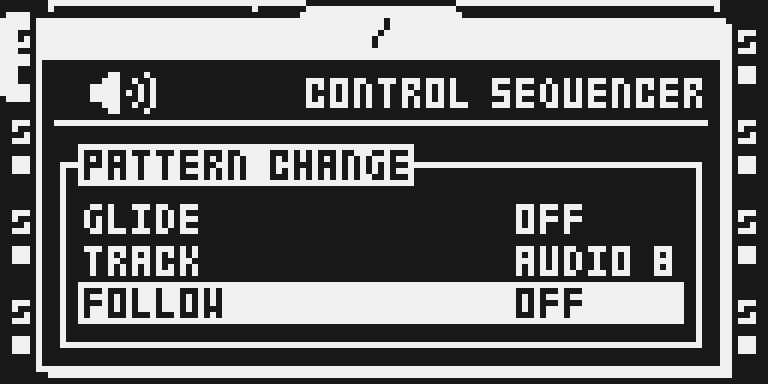

# Scale Quantizer

Version: `0.1.4-experimental`, for Octatrack OS 1.40C.

## Overview

Scale Quantizer adds SCALE, ROOT, GLIDE, TRACK and FOLLOW to
PROJECT > CONTROL > SEQUENCER. Pitch edits, parameter locks and chromatic trig
keys follow the selected scale and root, and so does what the tracks play:
recorded notes follow a scale change. Version 0.1.4 brings the author's 2.21
quantizer: MIDI tracks, the per-track switches and the scale-following playback
([#439](https://github.com/repeat98/modwerk/issues/439)). The per-track
switches are two rows, TRACK and FOLLOW, so the module's five rows fit the
base's SEQUENCER table on the card and over USB alike.

## Controls

- **SCALE:** OFF or one of 24 scales. OFF restores stock pitch behavior.
- **ROOT:** C–B. Transposes the selected scale and the chromatic keyboard;
  ignored with SCALE OFF.
- **GLIDE:** OFF or 1–127. Slide time depends on the track's LEG setting.
  Synth-specific glide and polyphony require the separate FM Synth module.
- **TRACK:** AUDIO 1..8, then MIDI 1..8. Picks the track FOLLOW shows and
  changes no sound. It is not a setting: it starts at AUDIO 1 at power-on and is
  not saved with the project.
- **FOLLOW:** ON (default) or OFF for the track TRACK shows; turning TRACK
  shows the newly picked track's value at once. OFF keeps that track stock in
  every path: on an audio track PTCH, locks, chromatic keys and what it plays;
  on a MIDI track the NOTE knob, NOTE locks, chromatic keys and what it plays.
  Each track's FOLLOW is saved with the project (the same `#` lines and
  battery-RAM bits as the 2.19-2.21 per-track rows, so their projects load the
  same).

## Usage

On a Flex, Static or Pickup track, PTCH steps through scale degrees, and
parameter locks and chromatic trig keys use the same root-rotated scale. When a
pattern plays, a Static or Flex track's pitch (its PTCH lock or the Part's
value) is snapped to the scale as the trig is played, so notes recorded before a
scale change play in the new scale. On a MIDI track the NOTE knob, NOTE locks
and chromatic keys step through the scale from ROOT, and the notes the track
sends (NOTE, the chord notes, TRAN and the arpeggiator) are snapped to the
nearest scale note. The settings are project settings kept in battery RAM and
saved in the project as `#` lines, which a stock unit skips.

### Quick tutorial: choose a scale

1. Open PROJECT > CONTROL > SEQUENCER and scroll to SCALE. Turn LEVEL to select MAJOR; OFF restores stock pitch behavior.
2. Scroll to ROOT and turn LEVEL to choose C. ROOT transposes the selected scale and the audio chromatic keyboard.
3. Close the project menu, select a Flex or Static audio track with a sample assigned, and turn PTCH or play the chromatic trig keys. Notes follow the selected scale; recorded notes play in it too.
4. Back in SEQUENCER, set TRACK to AUDIO 1 (or MIDI 1) and FOLLOW to OFF: that track plays unquantized while the others follow the scale.

## Compatibility and limitations

The module adds ColdFire control hooks and no continuous DSP audio engine. RATE
is not a semitone control.

FM Synth carries its own copy of this quantizer, because its engine shares the
quantizer's key mailbox and scale accessor. Both modules install together:
FM Synth bundles this module's source byte for byte, so the card build keeps
one quantizer, this module's hooks and five rows aimed at FM Synth's copy,
and FM Synth's own quantizer hooks and rows left out (the octabam SDK's
composition rule `shared_supply`, `tools/remix/machine_composition.py`, from
this module's `composition.json`; pending the owner's review). SEQUENCER
shows SCALE, ROOT, GLIDE, TRACK and FOLLOW once; FM SYNTH tracks follow the
scale as with FM Synth alone, and FOLLOW takes them out like any audio track
(with the author's `3531b8e` in FM Synth; on the earlier be2810f build an FM SYNTH
track set OFF kept its keys snapped and only lost the ROOT transpose).

On the Modwerk USB base the eighteen quantizer sites that FM Synth and POLY8
also use are base events, and the SEQUENCER rows are the base's table; the
nine other hooks (seven since 2.19, two more for 2.21's panel publication) stay
guarded patches. The base's SEQUENCER table shows stock's three rows and up to
eight contributed rows; this module contributes five (SCALE, ROOT, GLIDE,
TRACK, FOLLOW), and card builds show the same five.

Current-source audio, physical hardware, Part/project persistence, power-cycle
survival, chip timing and complete memory bounds remain untested on this
version. See [TESTING.md](TESTING.md) for exact evidence and limits.

## Tests and measurements

[TESTING.md](TESTING.md) records the commands, the source revision and every
result of this version: the native card build, the USB package, the compat and
doctor runs and the emulator smoke. No current-build physical hardware or
chip-cycle measurements are claimed.

## Authorship and licences

Tim Hastie authored Scale Quantizer in
[timhastie/octatrick-modules](https://github.com/timhastie/octatrick-modules),
pinned here to `990eff8bf88463af4d396793f1c60eb1dab34ea0` (his 2.21 quantizer
plus the TRACK / FOLLOW rows; not yet published), with the hook comments in words
and every guard read through `stock_guard`). Sam Banks
provided the Octabam wrapper up to 0.1.3. Vendored source remains MIT licensed
with its original notices in [LICENSE](LICENSE) and
[upstream/LICENSE](upstream/LICENSE). Nothing inside `upstream/` is edited.

Original framebuffer captures use
[LicenseRef-OT-UI-Documentation](media/LICENSE.md). Underlying Elektron interface
rights remain reserved. No firmware or extracted stock image is distributed.

## Screens and audio

These are emulator-rendered LCD captures of this version, with stopped transport
and an empty disposable card. They document the interface only. [Capture provenance](media/capture.json) records the exact local image,
emulator, panel plan and PNG hashes. No audio preview or hardware audio evidence
is supplied.

