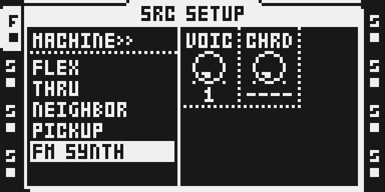
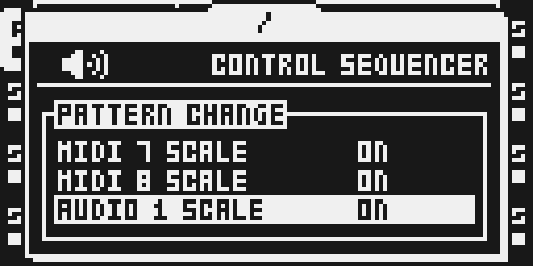

# FM Synth — 0.1.4 experimental

## Overview

FM SYNTH is a dedicated track machine beside FLEX, STATIC, THRU, NEIGHBOR and PICKUP. It is Tim Hastie’s two-operator FM engine from his Octatrick 2.20 line: a sine carrier with a sine modulator, feedback and an index-decay envelope, one to four paraphonic voices with chord shapes, MIDI, legato and glide, through the track’s existing AMP, filter and effects. The scale quantizer that the engine reads (SCALE, ROOT, GLIDE and the per-track MIDI / AUDIO SCALE rows) is bundled privately.

`upstream/synth` and `upstream/quantizer` are the author’s files at release 2.20 (tag `v2.20`, `9b62d5d96bdd21f846ec1b365ba36e8c78f2ef63`), byte for byte. The author’s [README](upstream/synth/README.md) describes every feature and its measurements.

What changes for players since 0.1.2:

- Step and scene locks on every FM control; VOIC and CHRD under LFOs and scenes ([#751](https://github.com/repeat98/modwerk/issues/751)); the LFO destination list names the FM controls ([#589](https://github.com/repeat98/modwerk/issues/589)).
- The click at note start and end is gone ([#557](https://github.com/repeat98/modwerk/issues/557)); a chord’s first trig follows the AMP envelope ([#710](https://github.com/repeat98/modwerk/issues/710)).
- LFOs and scene locks on AMP ATK, HOLD and REL shape the sound, and an LFO on PTCH moves the pitch as far as on FLEX, following Jan Kolkmeier’s report and fix in [#883](https://github.com/repeat98/modwerk/issues/883) / [#884](https://github.com/repeat98/modwerk/pull/884).
- A selection guard: a Part holds at most two FM SYNTH tracks, and the voices are capped so the Part stays inside the CPU budget. A machine change to or from FM SYNTH resets the track’s machine parameters to init (locks are kept, as in stock).
- The scale quantizer also follows the scale on MIDI tracks (NOTE knob, locks, chords, TRAN, the arpeggiator) and on audio tracks; MIDI 1..8 SCALE and AUDIO 1..8 SCALE take a track out of it.
- Card builds keep the SRC page out of the 16 bytes the stock DELAY reads past its 508-entry table at a slow tempo with a long TIME (zero on a stock unit; 0.1.2 kept page code there): the page is a DRAM unit, as in Jannik Aßfalg’s [#895](https://github.com/repeat98/modwerk/pull/895) for 0.1.3. Nothing you see or play on FM Synth changes.
- Level: about 12 dB louder than 0.1.2 at the same settings. The engine keeps 6 dB of headroom instead of 0.1.2’s 18 dB; AMP VOL 0 is the reference, and VOL above it can clip a full-scale voice.

## Controls

| Page | Control | Initial value / range | Function |
| --- | --- | --- | --- |
| SRC A | PTCH | raw 64; −64…+63 semitones | Carrier pitch; chromatic and scale edits constrain notes. |
| SRC B | RATO | raw 12 = 1; 32 ratios 0.25…16 | Modulator/carrier frequency ratio. |
| SRC C | INDX | 32; 0…127 | FM depth; 0 gives the unmodulated carrier. |
| SRC D | FINE | raw 64 = 0; −64…+63 cents | Fine pitch tuning. |
| SRC E | FDBK | 0; 0…127 | Modulator feedback. |
| SRC F | DEC | 40; 0…127 (127 = hold) | Decay of the modulation index, separate from amplitude. |
| FUNC+SRC (SETUP) | VOIC | 1; 1…4 | Paraphonic voices (the former LOOP box). |
| FUNC+SRC (SETUP) | CHRD | none; 32 shapes × 4 inversions | Chord shape and inversion (the former SLIC box). |
| FUNC+AMP F | LEG | OFF / MONO / POLY | Retrigger or overlapping mono/paraphonic legato. |
| PROJECT > CONTROL > SEQUENCER | SCALE, ROOT, GLIDE | OFF; 24 scales / C…B / OFF, 1…127 | Scale quantization, its key, the legato slide time. |
| Same menu | MIDI 1..8 SCALE, AUDIO 1..8 SCALE | ON | OFF takes that track out of the scale. |

AMP ATK, HOLD and REL drive the engine’s own gain envelope, with their locks, scenes and LFOs. An LFO on PTCH moves the pitch 0.2 semitone per unit of depth, as on FLEX; FLEX’s PTCH stops at ±12.8 semitones, an FM SYNTH track’s range goes further.

## Usage

FM SYNTH is chosen per track in SRC SETUP’s machine list, like FLEX or STATIC, and needs no sample. A Part holds at most two FM SYNTH tracks. The SRC page holds the FM controls, SRC SETUP (FUNC+SRC) holds VOIC and CHRD, AMP shapes the gain envelope as on any track, and the scale, its root and the glide time are set in PROJECT > CONTROL > SEQUENCER.

### Quick tutorial: play FM Synth

1. Open a disposable project with FM Synth firmware. Select an audio track, hold FUNC and press SRC, select FM SYNTH with UP/DOWN and press YES. No sample is required.
2. Press SRC. Set RATO to 1 and turn INDX from 0 upwards to hear a sine tone acquire FM harmonics. PTCH transposes it; FINE tunes it in cents; FDBK adds feedback; DEC shortens the modulation envelope.
3. Place a trig and press PLAY. In SRC SETUP (FUNC+SRC) set VOIC to 2–4 and CHRD to a chord if wanted. AMP ATK/HOLD/REL shape the gain envelope; FUNC+AMP exposes LEG.
4. Press STOP twice to silence the voice. To return to a sample machine, hold FUNC and press SRC, select FLEX or STATIC and press YES; assign the desired sample in the normal way.

For scales and glide, open PROJECT > CONTROL > SEQUENCER.

## Compatibility and limitations

OS 1.40C only. Parts store internal FLEX kind 1 plus `FM/1` in unused NEIGHBOR bytes. A stock build reads the track as FLEX and cannot synthesize FM; select a stock machine explicitly before downgrading.

The matching quantizer is bundled privately because the engine shares its mailbox and scale accessor. Do not combine with the public Scale Quantizer or Analog BD: their hooks overlap. Beside POLY8 this version does not build yet: POLY8’s composition record covers 0.1.2’s machine-list sites, not 0.1.4’s (see TESTING.md, [#941](https://github.com/repeat98/modwerk/issues/941)). FM Synth installs alone: the author’s SY DRUM rows are not assembled here, and his trig-mute rule (2.19, which in his own builds reads Mute Modes’ words) reads two words of this module’s `port.s` instead. Over USB those words would carry the base’s answer to `ev_trig_muted` ([#912](https://github.com/repeat98/modwerk/pull/912)), so a track a mute module silences starts no new FM note; on a card build, and on a base without that event, they stay 0 and every trig plays, as in 0.1.2.

This version installs with a card build. Its USB package for the Octatrack base cannot be built yet: the engine’s DRAM regions (the step-lock work table, the scene table, the project migration buffers) and the units’ generated includes are refused in a runtime package. The machine-port lines for the base (`sdk/machines/octatrack/module-adapters/machine-ports.json`) are prepared: the machine record does the author’s selection guard, its popup and his machine-change init at the base’s chooser commit, and two hooks still meet base sites (see TESTING.md).

## Tests and measurements

See [TESTING.md](TESTING.md). Hardware is untested for this build.

## Authorship and licences

Tim Hastie: FM engine, machine list, PLAYBACK page, step and scene locks, voices/chords, MIDI/legato and the bundled quantizer, pinned to `9b62d5d96bdd21f846ec1b365ba36e8c78f2ef63` (Octatrick 2.20, tag `v2.20`). Jan Kolkmeier: the report and fix of the AMP envelope under LFOs and scenes and of the LFO PTCH depth (#883 / #884), folded into 2.20. Jannik Aßfalg: the SRC page as a DRAM unit, out of the stock DELAY’s table tail (#895), folded into 0.1.4. Sam Banks: octabam wrapper/platform. Modwerk contributors: the chooser the author’s machine list is adapted from, Part signature, sample-free source transport, verification, docs and original SVG. Full MIT terms are in [LICENSE](LICENSE) and [upstream/LICENSE](upstream/LICENSE).

No firmware, extracted stock byte blobs/tables, cards, RAM dumps or compiled images are distributed. Every stock expectation is a Modwerk `stock_guard(address, length, sha256)` in `manifest.py` (listed in `stock-guards.json`) and resolves lazily from the verified developer-owned OS. The author’s manifests carry no stock bytes: both read every guard through their `stock_guard.py`, which this wrapper answers from its own table, and the PLAYBACK page is ratified by its length and SHA-256.

## Screens and audio

The captures are from this version’s native card build (headless ot_emu, MAIN `d036ed7d`, the SRC page in DRAM, 26 October 2026), byte-identical to those from MAIN `c6ce3ac1` and to the 25 October captures from MAIN `79b3b1da` (the page in the author’s cave); five of them are byte-identical to 0.1.2’s. The audio preview is from 0.1.2 and has not been retaken.

