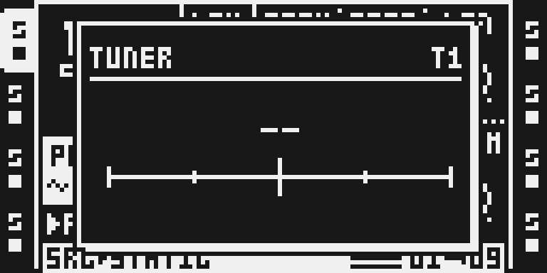
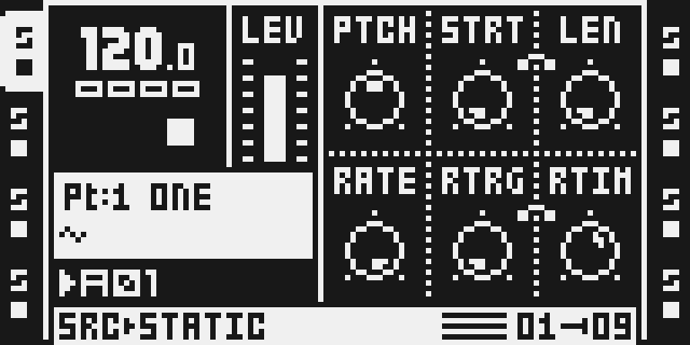
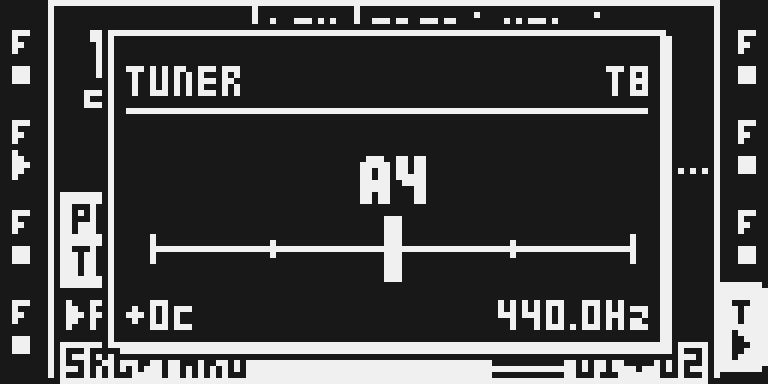
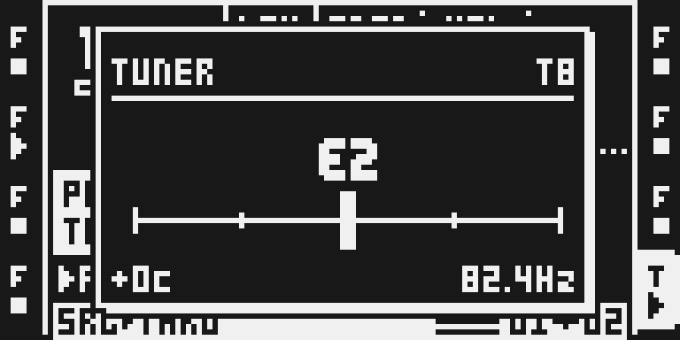
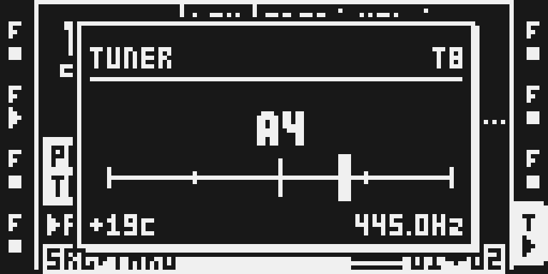

# Tuner

Version 0.1.0-experimental. Tim Hastie’s Tuner, packaged for Modwerk from the exact v2.20 source; emulator-qualified, hardware pending.

## Overview

Hold **UP first, then press TEMPO** to open a pitch readout for the selected audio track. The source provides note and octave, signed cents, frequency and a needle around the nearest note, with A4 fixed at 440 Hz. It reads after track effects and before the fader, uses no effect slot and is designed to leave the audio unchanged.

**Card builds only: the base has no removal refusal for ordinary modules.** USB support is optional future work; the earlier admission proposal is retained in [evidence/usb-admission.md](evidence/usb-admission.md), not implemented or required for this card-only draft.

On the emulator (29 October 2026) the canonical card build reads a tone on the input live: A4 +0c 440.0Hz, E2 +0c 82.4Hz and A4 +19c 445.0Hz, with its cost and memory measured under an eight-track load. Hardware qualification is pending. [TESTING.md](TESTING.md) has the numbers and the earlier records.

## Controls

| Action | Intended result |
| --- | --- |
| Hold UP first, then press TEMPO | Open the tuner, or close it if already open. |
| TEMPO, YES or NO while open | Close the tuner window. |
| Select an audio track | Read that track; MIDI mode retains the selected audio track. |
| TEMPO alone | Ordinary tempo window. |
| FUNC + TEMPO | Ordinary tapping gesture. |

There are no editable tuner parameters, locks, LFO destinations or calibration controls. Below the signal or confidence threshold, the source retains the last valid reading. A held reading is not a fresh pitch estimate. Before the first valid reading, the display has no pitch result.

## Usage

Open the window on the track you want to tune and play a steady pitched sound on it; the reading refreshes about seven times a second.

### Quick tutorial: tune a sound on a track

1. Select the audio track to tune with its track key. Tuner reads the track after its effects and before its fader, so a quiet or faded track still reads.
2. Hold UP first, then press TEMPO. The window shows the track, the note and octave, a +-50 cent needle, the cents and the frequency.
3. Play a steady pitched sound on that track (a THRU track with an instrument on input A, or a sample) and adjust it until the needle is centred and the cents read +0c.
4. Below the signal gate or without a clear pitch the last reading stays with HOLD in the header. Press TEMPO, YES or NO, or UP + TEMPO again, to close the window.

## Screens and audio

These are preserved LCD pixels from the earlier native candidate using a separately identified source-built emulator. This is a tooling substitution, not a firmware fix. No audio was played or recorded, and the standalone 2.19 reference exited before capture, so no paired visual equivalence is established.

Select an audio track before opening Tuner. The starting page is unobstructed.

Hold UP first, then press TEMPO. The tuner window is visible here, but its pitch readout is unpopulated; the ruler and center mark do not prove a working live needle.

Press TEMPO to close. The track page is visible again, with no tuner overlay.

More screenshots retain the alternate [NO close state](media/03-closed-no.png), [YES close state](media/04-closed-yes.png), [ordinary tempo window](media/06-normal-tempo.png) and [tempo-tapping dialog](media/07-func-tempo.png). All seven images were reviewed. The unmodified [capture record](media/capture.json) binds their identities and input plan; [the UI evidence note](evidence/ui-capture-2026-10-26.json) records the tooling and qualification limits. The [thumbnail](presentation/thumbnail.svg) is conceptual artwork, not an instrument capture.

### Live readings (emulator, 29 October 2026)

A 440 Hz sine on input A, T8 THRU selected, the eight-track fixture playing: A4, the needle centred, +0c, 440.0Hz.

The low E string, 82.41 Hz: E2 +0c 82.4Hz.

445 Hz, about 20 cents sharp of A4: the needle sits right of centre and the cents read +19c (the cents table steps 0.42 cents).

## Compatibility and limitations

- Targets OS 1.40C and declares `key:UP+TEMPO`. The historical source describes both Octatrack models; this capture used an MKII panel, not physical hardware.
- It estimates one pitch. Complex, noisy or inharmonic sounds can wander or select an octave. Track effects can change the estimate.
- Track level and the crossfader act after the tapped signal; lowering final output does not necessarily stop the readout.
- No tuner setting is stored in a Part, project, card or battery RAM. The window and working history are temporary.
- The private declaration compatibility check passed on the earlier fixture. Companion behavior and current-base runtime compatibility remain unqualified.
- An older retained emulator failed in its DSP write callback. Which image property triggers that fault remains unresolved; the current capture does not justify a Tuner firmware correction.
- The detector removes no DC offset. A signal whose DC offset is larger than its AC (RMS) level (one fixture track after its effects, on the emulator) shows HOLD instead of a reading.
- Card-only acceptance does not supply hardware qualification, and does not waive the catalogue’s evidence requirements.

## Tests and measurements

Emulator, 29 October 2026, canonical card build (MAIN OS `91bf159e…`), eight-track fixture playing ([TESTING.md](TESTING.md), [evidence](evidence/qualification-emulator-2026-10-29.json)):

| Measure | Result |
| --- | --- |
| Readings | 440 Hz A4 +0c, 82.41 Hz E2 +0c, 445 Hz A4 +19c, 110 Hz A2 −1c; noise and silence HOLD |
| Frame interrupt, every block | 195 instructions open, 4 closed |
| Analysis and redraw, every 400 blocks (UI task) | at most 1,008,258 instructions (9.5 ms at 9.44 ns) |
| Per block, amortised worst case | 6,769 of 9,577 cycles (instruction-count model, 264 MHz) |
| Memory | 33,019 B of its own (2,830 code, 19,500 data, 8,194 link gap, 2,241 appended loader and unit, 18 hook sites, 236 stack) plus the DRAM platform reserve |

Not yet measured on hardware. The earlier native build, declaration check and UI walk records stay in [TESTING.md](TESTING.md).

## Authorship and licences

Tuner is by **Tim Hastie (@timhastie)**, from `timhastie/octatrick-modules` tag `v2.20`, commit `fd18f5530989be348e6aa4c6e38f93beba555e6d`. All four files in `upstream/` are unchanged. The local wrapper preserves the upstream runtime/source declarations and replaces the three detour expectations with verified Modwerk-form hash guards; [guard provenance](evidence/guard-provenance.json) records that adapter change. The preserved card image predates both that adapter and this source update. The immutable upstream reader needs the build working directory's local MAIN section before manifest import; the Modwerk wrapper then replaces the three expectations with lazy digest guards. No current-source build or check was run during the re-vendor.

The upstream MIT terms remain in [LICENSE](LICENSE). Octabam supplies the native platform. Documentary screenshots retain the underlying interface rights; firmware is not included. No hardware endorsement or affiliation is asserted.
